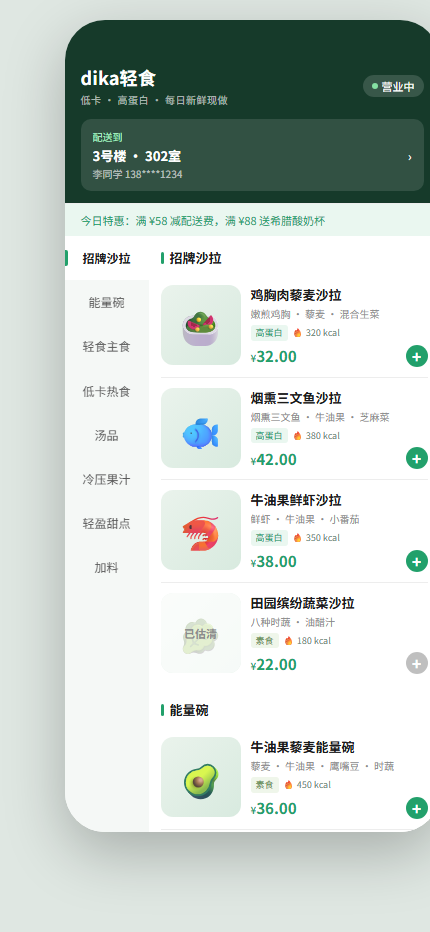
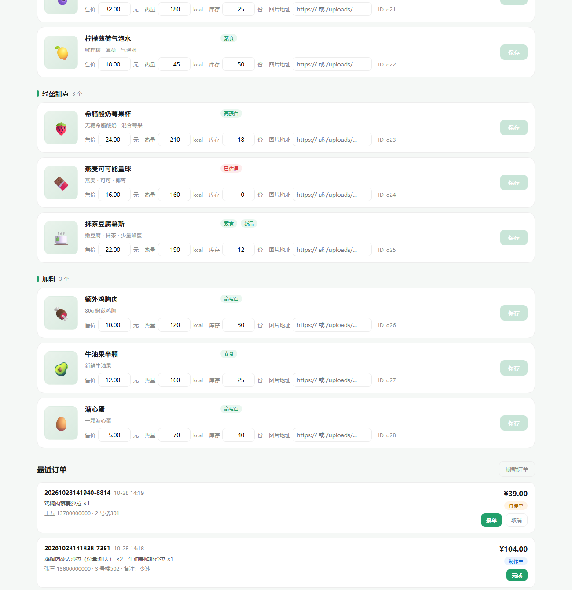

# dika-light-meal-miniprogram

> 低卡轻食点餐系统 —— 2026 第九届传智杯全国大学生数智创新与 AI 应用大赛「AI 创新应用挑战赛」（个人赛）参赛作品

一套面向轻食门店的**点餐 + 后台管理**最小可用闭环：顾客端 H5 完成选餐、规格选择、购物车、地址与结算下单；商家端后台完成菜品价格 / 库存 / 热量 / 图片的维护，并接单、完成订单。服务端为零第三方依赖的原生 Node HTTP 服务，数据以 JSON 文件持久化。

| 顾客端点餐页 | 商家端后台（订单区） |
|---|---|
|  |  |

---

## 一、功能清单

### 顾客端点餐页（`/`）

- 8 个类目（招牌沙拉 / 能量碗 / 轻食主食 / 低卡热食 / 汤品 / 冷压果汁 / 轻盈甜点 / 加料），28 道菜品
- 左侧类目导轨与右侧菜品列表**滚动双向联动**，点击导轨平滑定位
- 菜品卡片展示价格、热量、库存、标签（高蛋白 / 素食 / 新品），**售罄自动置灰**
- **规格 SKU 弹层**：多规格组（必选 / 可选），加价项实时联动单价，未选满必选项禁止加入购物车
- 购物车：底部悬浮结算栏、数量角标、**加入购物车飞入动画**、热量合计
- 地址簿：增删改、默认地址、`localStorage` 本地持久化
- 结算页：商品明细、配送费 ¥5、打包费 ¥2、**满 ¥58 免配送费**、订单备注与表单校验
- **提交订单**：`POST /api/orders` 服务端重算金额并落库，跟踪页展示**真实订单号、金额与下单时间**
- 骨架屏加载、Toast 轻提示

### 商家端后台（`/admin`）

- 经营数据概览（菜品数、类目数、售罄数等统计）
- 类目筛选 chips + 菜品列表
- 行内编辑：名称、描述、价格、库存、热量
- **图片上传**（前端转 dataURL → 服务端落盘 `uploads/`，限 2MB，支持 png/jpg/webp/gif）
- **订单管理**：最近订单列表（商品明细 / 地址 / 备注 / 金额），状态流转「待接单 → 制作中 → 已完成」或取消

---

## 二、技术栈

| 层 | 选型 | 说明 |
|---|---|---|
| 服务端 | Node.js 原生 `http` / `fs` / `path` | **零第三方依赖**，无 `package.json`，`node server/server.js` 即启动 |
| 顾客端 | 原生 HTML + CSS + JS（单文件） | 无框架、无构建，`preview/index.html` 直出 |
| 后台 | 原生 HTML + CSS + JS（单文件） | `admin/index.html` |
| 数据 | `data/menu.json`、`data/orders.json` | 原子写：先写 `.tmp` 再 `rename`；订单文件运行时自动创建 |
| 静态资源 | `uploads/` | 上传图片本地落盘 |

价格字段统一以**分**为整数存储（`3200` = ¥32.00），避免浮点误差；展示层 `fenToYuan()` 转换。

---

## 三、目录结构

```
dika-light-meal-miniprogram/
├── admin/
│   └── index.html        # 商家后台（菜品管理 + 订单管理）
├── data/
│   ├── menu.json         # 菜单数据（8 类目 / 28 菜品 / 规格组 / 计费规则）
│   └── orders.example.json  # 订单结构示例（运行时生成 data/orders.json，已 gitignore）
├── docs/
│   └── screenshots/      # 界面截图（README 引用）
├── preview/
│   └── index.html        # 顾客端点餐 H5（单文件，1743 行）
├── prompts/              # AI 协作过程归档（规范见 prompts/README.md）
│   ├── README.md
│   └── 01-订单落库.md
├── server/
│   └── server.js         # 零依赖 HTTP 服务 + 静态托管 + API
├── uploads/              # 运行时上传目录（内容不进仓库，保留 .gitkeep）
├── .env.example          # 环境变量模板
├── .gitignore
├── start.bat             # Windows 一键启动
├── start.sh              # macOS / Linux 一键启动
└── README.md
```

---

## 四、10 分钟极速复现指南

### 1. 环境要求

- **Node.js ≥ 18**（无 npm 依赖，无需 `npm install`）
- 现代浏览器（Chrome / Edge 90+）

```bash
node -v   # 期望 v18.x 及以上
```

### 2. 获取代码

```bash
git clone git@github.com:grorge00/dika-light-meal-miniprogram.git
cd dika-light-meal-miniprogram
```

### 3. 环境变量（可选）

```bash
cp .env.example .env
# Windows PowerShell: Copy-Item .env.example .env
```

`.env.example` 内容：

```
PORT=3000
```

> 本项目不读取 `.env` 文件（零依赖，无 dotenv），环境变量由系统传入：
> Windows `set PORT=8080 && node server\server.js`，macOS/Linux `PORT=8080 node server/server.js`。

### 4. 启动

```bash
# Windows
start.bat

# macOS / Linux
bash start.sh

# 或直接
node server/server.js
```

看到如下输出即启动成功：

```
dika轻食 server running at http://localhost:3000
点餐页  http://localhost:3000/preview/index.html
后台    http://localhost:3000/admin
```

### 5. 访问

| 入口 | 地址 |
|---|---|
| 顾客端点餐页 | http://localhost:3000/ （或 `/preview/index.html`） |
| 商家端后台 | http://localhost:3000/admin |

### 6. 功能自检清单（5 分钟走通）

1. 点餐页加载出 8 个类目，滚动右侧列表，左侧导轨高亮自动跟随；
2. 点任一菜品「选规格」→ 选择必选规格 → 单价实时变化 → 加入购物车 → 观察飞入动画与角标；
3. 购物车结算 → 新增地址 → 提交订单，核对「满 ¥58 免配送费」与总价、总热量；提交成功后跟踪页应显示**真实订单号**，购物车清空；
4. 打开 `/admin` → 改某菜品价格 / 库存 / 上传图片 → 刷新点餐页确认已生效（数据写回 `data/menu.json`）；
5. 在同一页面下滑到「最近订单」→ 找到刚下的单，点「接单」→ 状态变「制作中」，再点「完成」→「已完成」；
6. 回到点餐页，售出菜品的库存应已减少；把某菜品库存改成 0 后再下单，应提示「库存不足」且停留在结算页。

---

## 五、API 说明

服务端统一响应体：`{ code: 0, data: ... }`，异常时 `{ code: <http 码>, message: "..." }`。

| 方法 | 路径 | 请求体 | 说明 |
|---|---|---|---|
| GET | `/api/menu` | — | 返回整份菜单（`categories` + `dishes` + `fees`） |
| PUT | `/api/dishes/:id` | `{ price?, stock?, calorie?, image?, name?, desc? }` | 更新单个菜品；`price/stock/calorie` 须为非负整数，`name` 须非空 |
| POST | `/api/upload` | `{ dataUrl, filename }` | 图片以 base64 dataURL 提交；限 2MB，白名单 png/jpg/jpeg/webp/gif；返回 `{ url: "/uploads/xxx" }` |
| POST | `/api/orders` | `{ items:[{ dishId, qty, unitPrice, specDesc? }], address:{ name, phone, building, room }, remark? }` | **下单**。服务端校验菜品存在、单价不低于基础价、库存充足，重算小计/配送费/打包费/合计/总热量，扣减库存后落库；返回订单号与金额 |
| GET | `/api/orders?limit=50` | — | 订单列表，按创建时间倒序，`limit` 上限 200 |
| PUT | `/api/orders/:id` | `{ status }` | 状态流转：`accepted` / `done` / `canceled`（不可改回 `pending`） |
| GET | `/*` | — | 静态文件托管；`/` → 点餐页，`/admin` → 后台；`/data`、`/.trae`、含 `..` 的路径一律 403 |

下单接口的错误语义：`400` 参数非法 / 菜品不存在 / 单价低于基础价；`409` 库存不足；`413` 请求体过大。

安全细节：`readBody()` 带体积上限（普通请求 64KB、下单 256KB、上传 8MB）防内存打爆；`writeMenu()` / `writeOrders()` 均采用「临时文件 + rename」原子写，避免写坏 JSON；金额与库存只在服务端计算，前端传值不作为最终依据；静态服务做 `path.join` 前缀校验防目录穿越。

---

## 六、数据模型

`data/menu.json`：

```jsonc
{
  "categories": [ { "id": "c1", "name": "招牌沙拉" } ],
  "dishes": [
    {
      "id": "d1",
      "cat": "c1",              // 所属类目
      "name": "鸡胸肉藜麦沙拉",
      "desc": "嫩煎鸡胸 · 藜麦 · 混合生菜",
      "price": 3200,            // 单位：分
      "calorie": 320,           // 单位：kcal
      "image": "",              // 上传后为 /uploads/xxx.jpg
      "emoji": "🥗",            // 无图时的占位
      "stock": 20,
      "tags": ["高蛋白"],
      "specs": [                // 可选规格组（部分菜品有）
        { "id": "g1", "name": "份量", "required": true,
          "options": [ { "id": "o1", "name": "标准", "delta": 0 } ] }
      ]
    }
  ],
  "fees": {                     // 计费规则（服务端与前端共用同一份）
    "deliveryFee": 500,         // 配送费 5 元
    "packFee": 200,             // 打包费 2 元
    "freeDeliveryThreshold": 5800  // 满 58 元免配送费
  }
}
```

`data/orders.json`（运行时生成，结构见 `data/orders.example.json`）：

```jsonc
[
  {
    "id": "20261028120304-4821",     // yyyyMMddHHmmss-4位随机
    "status": "pending",              // pending | accepted | done | canceled
    "items": [
      { "dishId": "d1", "name": "鸡胸肉藜麦沙拉", "specDesc": "份量:加大",
        "unitPrice": 3200, "qty": 2, "calorie": 320, "amount": 6400 }
    ],
    "address": { "name": "张三", "phone": "13800000000", "building": "3 号楼", "room": "502" },
    "remark": "少冰",
    "subtotal": 6400,
    "deliveryFee": 0,                 // 服务端按 fees 重算
    "packFee": 200,
    "total": 6600,
    "totalCalorie": 640,
    "itemCount": 2,
    "createdAt": "2026-10-28T04:03:04.000Z",
    "updatedAt": "2026-10-28T04:03:04.000Z"
  }
]
```

---

## 七、已知限制与后续规划

| # | 现状 | 规划 |
|---|---|---|
| 1 | 仓库名含 `miniprogram`，但当前主体为 **H5 版式**，尚无微信小程序工程（`app.json` / `*.wxml`） | 迁移为小程序端，或更名为 web 版并保留 H5 |
| 2 | 订单已落库，但**无支付、无退款、无配送状态回传**，跟踪页进度条仍是演示态 | 接支付与配送回调，进度由订单状态驱动 |
| 3 | 下单扣库存是 `read → 改 → write`，多请求并发时存在**竞态窗口**（单机演示可接受） | 加文件锁，或换 SQLite / 数据库事务 |
| 4 | 后台与 `GET /api/orders` **无鉴权**，订单含手机号与地址 | 加登录态与角色校验，列表脱敏 |
| 5 | JSON 文件存储，历史订单只保留最近 2000 条，无分页 | 换数据库 + 分页 + 归档 |
| 6 | 上传图片存本地 `uploads/`，无 CDN、无清理策略 | 接对象存储 + 定时清理 |

---

## 八、比赛提交对照（AI 创新应用挑战赛 · 个人赛）

| 赛项要求 | 当前状态 |
|---|---|
| GitHub/Gitee 公开仓库 + 细粒度 Git 历史（禁一次性提交） | ✅ 仓库已建立，按模块拆分提交 |
| AI 对话 / Prompt 历史快照（≥3 个核心功能迭代链路） | 🟡 已建立 `prompts/` 归档机制与第 1 条记录（[01-订单落库](prompts/01-订单落库.md)），持续累积中 |
| README 10 分钟复现指南（环境、依赖、环境变量模板） | ✅ 见第四节 |
| 演示视频 MP4 1080p，5–8 分钟，含 ≥2 分钟 AI 协同复现 | ⬜ 待录制 |
| 技术文档 PDF ≤30 页（意图控制策略 / 架构设计 / 可复现性论证） | ⬜ 待撰写 |

> 说明：仓库最早的 6 次提交是**存量代码按模块导入**，早于 `prompts/` 归档机制建立，因此没有对应的 Prompt 记录，不做追溯性补写。自「订单落库」起，每次功能迭代按「一次 AI 对话 / 一个功能模块 = 一次 commit + 一份 Prompt 归档」推进。

---

## 九、许可

仅用于赛事评审与学习交流，作者保留权利。
