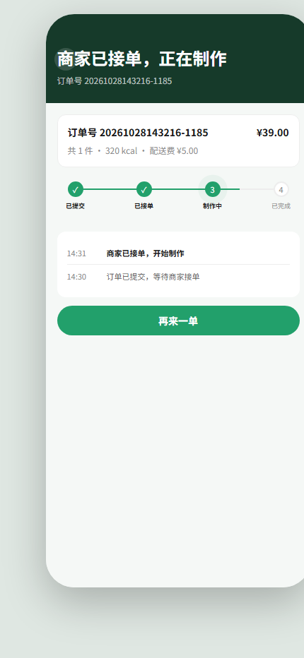
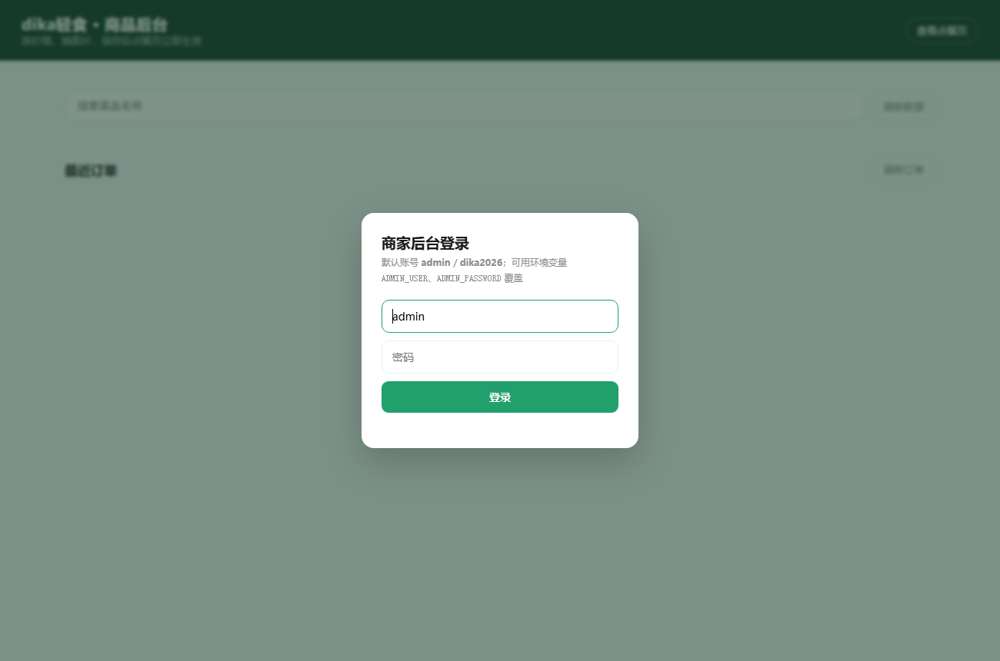

# dika-light-meal-miniprogram

> 低卡轻食点餐系统 —— 2026 第九届传智杯全国大学生数智创新与 AI 应用大赛「AI 创新应用挑战赛」（个人赛）参赛作品

一套后端，两个前端。

- `miniprogram/` —— 生产端：微信原生小程序（TypeScript），真正要上架的那一套
- `preview/` —— 展示端：H5，双击就能在浏览器里点，评审和演示时不用装小程序
- `admin/` —— 商家后台：改菜品、接单、完成订单
- `server/` —— 两端共用：零第三方依赖的 Node HTTP 服务，JSON 文件落盘

两端共用同一套 `/api/*`（见第六节），业务逻辑只写一遍。展示端没有微信登录和支付，换来的是打开链接就能用；上架要准备什么见[第四节](#四小程序端生产端运行与上架)。

## 这个项目的两条线

**开发上**，把 AI 当成可以分工的搭子：需求拆解、页面生成、Bug 修复分别派给 AI，我负责定约束、做取舍、跑验证。每轮迭代留一份「需求 → 取舍 → 验证」的记录，编号和提交对得上，见 `prompts/01~05`。

**业务上**，做的是小微轻食店用得起的接单工具：零依赖后端 + 双前端（小程序上架、H5 演示），外加一个按身体指标算套餐的推荐模块。推荐没有调大模型乱猜，用的是营养学公式加组合搜索，结果可复现；大模型只负责把结论写得更像人话，不参与计算。

| 顾客端点餐页 | 订单跟踪（状态由服务端驱动） |
|---|---|
|  |  |

| 商家端后台（订单区） | 后台登录 |
|---|---|
|  |  |

---

## 一、功能清单

### 顾客端点餐页（`/`）

- 8 个类目（招牌沙拉 / 能量碗 / 轻食主食 / 低卡热食 / 汤品 / 冷压果汁 / 轻盈甜点 / 加料），28 道菜品
- 左侧类目导轨与右侧菜品列表**滚动双向联动**，点击导轨平滑定位
- 菜品卡片展示价格、热量、库存、标签（高蛋白 / 素食 / 新品），**售罄自动置灰**
- **规格 SKU 弹层**：多规格组（必选 / 可选），加价项实时联动单价，未选满必选项禁止加入购物车
- 购物车：底部悬浮结算栏、数量角标、**加入购物车飞入动画**、热量合计
- 地址簿：增删改、默认地址、`localStorage` 本地持久化
- 结算页：商品明细、配送费 ¥5、打包费 ¥2、**满 ¥58 免配送费**、订单备注与表单校验
- **提交订单**：`POST /api/orders` 服务端重算金额并落库，跟踪页展示**真实订单号、金额与下单时间**
- **订单跟踪**：进入跟踪页后每 5 秒轮询 `GET /api/orders/:id`，进度条、状态文案与时间轴全部由订单**事件链**驱动，商家接单/完成后顾客端自动变化
- **AI 定制减脂套餐**：输入性别 / 年龄 / 身高 / 体重 / 活动量 / 目标，服务端按 Mifflin-St Jeor 算 BMR → TDEE → 目标热量，在菜单里做组合搜索，给出高蛋白、低偏差、低价的套餐，可一键加入购物车
- 骨架屏加载、Toast 轻提示

### 商家端后台（`/admin`）

- **登录鉴权**：Cookie 会话（HttpOnly + SameSite），默认 `admin` / `dika2026`，可用环境变量覆盖；同一 IP 连续 5 次失败锁定 60 秒
- 经营数据概览（菜品数、类目数、售罄数等统计）
- 类目筛选 chips + 菜品列表
- 行内编辑：名称、描述、价格、库存、热量
- **图片上传**（前端转 dataURL → 服务端落盘 `uploads/`，限 2MB，支持 png/jpg/webp/gif）
- **订单管理**：最近订单列表（商品明细 / 地址 / 备注 / 金额），状态流转「待接单 → 制作中 → 已完成」或取消

---

## 二、技术栈

| 层 | 选型 | 说明 |
|---|---|---|
| 服务端 | Node.js 原生 `http` / `fs` / `path` | **零第三方依赖**，根目录无 `package.json`，`node server/server.js` 即启动 |
| 生产端 | 微信原生小程序 + TypeScript（strict） | `miniprogram/`，不用 uni-app / Taro；运行时依赖 0，仅 2 个类型/编译开发依赖 |
| 展示端 | 原生 HTML + CSS + JS（单文件） | 无框架、无构建，`preview/index.html` 直出，双击即可看 |
| 后台 | 原生 HTML + CSS + JS（单文件） | `admin/index.html` |
| 数据 | `data/menu.json`、`data/orders.json` | 原子写：先写 `.tmp` 再 `rename`；订单文件运行时自动创建 |
| 静态资源 | `uploads/` | 上传图片本地落盘 |

价格字段统一以**分**为整数存储（`3200` = ¥32.00），避免浮点误差；展示层 `fenToYuan()` 转换。

---

## 三、目录结构

```
dika-light-meal-miniprogram/
├── admin/
│   └── index.html        # 商家后台（菜品管理 + 订单管理）
├── miniprogram/          # 生产端：微信小程序（TypeScript，运行时零依赖）
│   ├── app.json / app.ts / app.wxss
│   ├── pages/
│   │   ├── menu/         # 点餐页：类目、菜品、规格弹层、购物车
│   │   ├── plan/         # AI 定制套餐：身体指标 → 推荐结果 → 一键加购
│   │   ├── confirm/      # 确认订单：地址、费用、提交
│   │   └── tracking/     # 订单跟踪：状态 + 事件时间轴（5 秒轮询）
│   ├── services/         # config.ts（后端地址）+ api.ts（唯一数据出口）
│   ├── store/cart.ts     # 购物车单例（模块级，页面 onShow 同步）
│   ├── utils/format.ts
│   ├── project.config.json
│   └── tsconfig.json
├── data/
│   ├── menu.json         # 菜单数据（8 类目 / 28 菜品 / 规格组 / 计费规则）
│   └── orders.example.json  # 订单结构示例（运行时生成 data/orders.json，已 gitignore）
├── docs/
│   ├── tech-doc.html     # 技术文档源文件（A4 打印样式，可直接改）
│   ├── tech-doc.pdf      # 技术文档导出（21 页，≤30 页要求）
│   ├── 提交清单.md        # 赛项材料逐条对照：要求 → 我们的文件 → 状态
│   ├── video-script.md   # 演示视频分镜（含 2 分 30 秒 AI 协同复现段）
│   └── screenshots/      # 界面截图（README 与文档引用）
├── preview/
│   └── index.html        # 顾客端点餐 H5（单文件，1743 行）
├── prompts/              # 迭代记录（写法见 prompts/README.md）
│   ├── README.md
│   ├── 01-订单落库.md
│   ├── 02-后台登录与鉴权.md
│   ├── 03-订单状态驱动跟踪页.md
│   ├── 04-小程序端与双端架构.md
│   ├── 05-AI减脂套餐推荐.md
│   ├── 06-运行日志与CI.md
│   └── snapshots/        # 对话快照（真实报错、命令与纠偏过程）
│       ├── 01-建仓与推送排障.md
│       ├── 02-推荐引擎调参.md
│       └── 03-大模型润色的数字约束.md
├── server/
│   ├── server.js         # 零依赖 HTTP 服务 + 静态托管 + API
│   ├── recommender.js    # 减脂套餐推荐引擎（营养学模型 + 组合搜索，纯函数）
│   └── logger.js         # 结构化日志（JSON Lines，脱敏 + 按大小滚动）
├── logs/                 # 运行日志（gitignore，启动时自动创建）
├── .github/workflows/    # CI：语法检查 + 类型检查 + 接口冒烟
├── uploads/              # 运行时上传目录（内容不进仓库，保留 .gitkeep）
├── .env.example          # 环境变量模板
├── .gitignore
├── start.bat             # Windows 一键启动
├── start.sh              # macOS / Linux 一键启动
└── README.md
```

---

## 四、小程序端（生产端）：运行与上架

`miniprogram/` 是真正要上架的那一套；`preview/` 与 `admin/` 是网页端展示与运营。两者共用同一个后端与同一套接口，业务逻辑只写一遍。

### 1. 技术选型

| 项 | 选型 | 理由 |
|---|---|---|
| 运行容器 | 微信原生小程序 | 不用 uni-app / Taro：本项目只有 3 个页面，跨端框架的编译产物体积与调试成本反而更高 |
| 语言 | TypeScript（strict） | 由开发者工具原生编译（`project.config.json` 里 `useCompilerPlugins: ["typescript"]`），无需额外构建脚本 |
| 视图 | WXML + WXSS，750rpx 基准 | 与展示端共用同一套 CSS 变量色板，视觉一致 |
| 状态 | 模块级购物车单例 | 状态只有「一车商品」，用不到 mobx；页面 `onShow` 主动 `syncCart()` |
| 网络 | `wx.request`，统一封装 | 全部收口在 `services/api.ts`，页面不直接拼 URL |
| 持久化 | `wx.setStorageSync` | 只存收货地址，避免动辄上云 |

### 2. 本地运行

```bash
# 1) 先起后端（仓库根目录）
node server/server.js

# 2) 装类型依赖（只影响 IDE 提示与 tsc，不影响小程序运行）
cd miniprogram && npm install

# 3) 类型检查（当前 0 error）
npx tsc --noEmit
```

用**微信开发者工具**「导入项目」，目录选 `miniprogram/`（不是仓库根目录），AppID 可先用测试号。

> ⚠️ 必做：详情 → 本地设置 → 勾选「不校验合法域名、web-view、TLS 版本以及 HTTPS 证书」，否则 `http://localhost:3000` 会被拦截。

### 3. 页面与接口映射

| 小程序页面 | 对应 Web 页面 | 接口 |
|---|---|---|
| `pages/menu/index` | `preview/index.html` | `GET /api/menu` |
| `pages/confirm/index` | 结算页 | `GET /api/menu`（计费规则）、`POST /api/orders` |
| `pages/tracking/index` | 跟踪页 | `GET /api/orders/:id`（5 秒轮询） |

### 4. 上架前必须处理的事

| # | 事项 | 说明 |
|---|---|---|
| 1 | 后端换成 **HTTPS 域名** | 小程序不允许 http 请求；改 `miniprogram/services/config.ts`，并在 mp 后台「开发管理 → 服务器域名」加入 request 白名单 |
| 2 | 域名 **ICP 备案** | 境内服务器未备案无法加入白名单 |
| 3 | 小程序 **类目资质** | 餐饮 / 食品类目通常需《食品经营许可证》；纯工具类可免，但「点餐」大概率被要求餐饮类目 |
| 4 | **微信登录**（建议） | 当前顾客以「订单号」为凭证，未接 `wx.login`；上架版建议用 code2session 绑定 openid，订单才真正属于某个用户 |
| 5 | **微信支付**（如需在线收款） | 需商户号与支付回调；当前下单不涉及支付，属线下结算 |
| 6 | **隐私协议** | 用到手机号与地址，须在小程序后台配置《用户隐私保护指引》 |

> 结论：**代码层面具备上架条件**（原生小程序、运行时零依赖、无违规能力调用）；真正卡点是第 1–3 项的账号与资质准备，以及第 4–5 项要不要接登录和支付。

---
## 五、Web 展示端：10 分钟复现

### 1. 环境要求

- **Node.js ≥ 18**（无 npm 依赖，无需 `npm install`）
- 现代浏览器（Chrome / Edge 90+）

```bash
node -v   # 期望 v18.x 及以上
```

### 2. 获取代码

```bash
git clone git@github.com:grorge00/dika-light-meal-miniprogram.git
cd dika-light-meal-miniprogram
```

### 3. 环境变量（可选）

```bash
cp .env.example .env
# Windows PowerShell: Copy-Item .env.example .env
```

`.env.example` 内容：

```
PORT=3000
ADMIN_USER=admin
ADMIN_PASSWORD=dika2026
```

> 本项目不读取 `.env` 文件（零依赖，无 dotenv），环境变量由系统传入：
> Windows `set PORT=8080 && node server\server.js`，macOS/Linux `PORT=8080 node server/server.js`。
>
> 不设置 `ADMIN_USER` / `ADMIN_PASSWORD` 时使用默认值 `admin` / `dika2026`，启动日志会提示。**部署到公网前必须覆盖默认口令。**

### 4. 启动

```bash
# Windows
start.bat

# macOS / Linux
bash start.sh

# 或直接
node server/server.js
```

看到如下输出即启动成功：

```
dika轻食 server running at http://localhost:3000
点餐页  http://localhost:3000/preview/index.html
后台    http://localhost:3000/admin
```

### 5. 访问

| 入口 | 地址 |
|---|---|
| 顾客端点餐页 | http://localhost:3000/ （或 `/preview/index.html`） |
| 商家端后台 | http://localhost:3000/admin |

### 6. 功能自检清单（5 分钟走通）

1. 点餐页加载出 8 个类目，滚动右侧列表，左侧导轨高亮自动跟随；
2. 点任一菜品「选规格」→ 选择必选规格 → 单价实时变化 → 加入购物车 → 观察飞入动画与角标；
3. 购物车结算 → 新增地址 → 提交订单，核对「满 ¥58 免配送费」与总价、总热量；提交成功后跟踪页应显示**真实订单号**，购物车清空；
4. 打开 `/admin` → 用 `admin` / `dika2026` 登录 → 改某菜品价格 / 库存 / 上传图片 → 刷新点餐页确认已生效（数据写回 `data/menu.json`）；
5. 在同一页面下滑到「最近订单」→ 找到刚下的单，点「接单」→ 状态变「制作中」，再点「完成」→「已完成」；
6. 回到点餐页提交的订单，跟踪页会在 5 秒内自动刷新进度（可在两个标签页并排观察）；
7. 回到点餐页，售出菜品的库存应已减少；把某菜品库存改成 0 后再下单，应提示「库存不足」且停留在结算页；
8. 点后台右上角「退出登录」→ 页面回到登录遮罩；此时直接调 `GET /api/orders` 会返回 401。

---

## 六、API 说明

服务端统一响应体：`{ code: 0, data: ... }`，异常时 `{ code: <http 码>, message: "..." }`。

| 方法 | 路径 | 权限 | 请求体 / 说明 |
|---|---|---|---|
| POST | `/api/login` | 公开 | `{ username, password }`；成功写入 `HttpOnly` Cookie `dika_admin`，失败 401，同一 IP 5 次失败锁 60 秒（429） |
| POST | `/api/logout` | 公开 | 销毁会话并清 Cookie |
| GET | `/api/session` | 公开 | 返回当前登录用户；未登录 401，后台据此决定是否弹登录框 |
| GET | `/api/menu` | 公开 | 返回整份菜单（`categories` + `dishes` + `fees`） |
| GET | `/api/recommend/options` | 公开 | 推荐表单的可选项（性别 / 活动量 / 目标），H5 与小程序共用 |
| POST | `/api/recommend` | 公开 | 身体指标 → 推荐套餐：返回 BMR / TDEE / 目标热量 / 蛋白目标、组合明细、热量偏差与可解释的推荐理由；`useAI: true` 且配置了 `LLM_API_KEY` 时附带大模型润色文案 |
| POST | `/api/orders` | 公开（顾客） | `{ items:[{ dishId, qty, unitPrice, specDesc? }], address:{ name, phone, building, room }, remark? }`；服务端校验菜品、单价、库存，重算全部金额，扣库存后落库 |
| GET | `/api/orders/:id` | 公开（凭订单号） | 顾客端跟踪用；返回状态、事件链与脱敏手机号（`136****5678`），404 表示订单不存在 |
| PUT | `/api/dishes/:id` | 🔒 需登录 | `{ price?, stock?, calorie?, image?, name?, desc? }`；`price/stock/calorie` 须为非负整数，`name` 须非空 |
| POST | `/api/upload` | 🔒 需登录 | `{ dataUrl, filename }`；限 2MB，白名单 png/jpg/jpeg/webp/gif；返回 `{ url: "/uploads/xxx" }` |
| GET | `/api/orders?limit=50` | 🔒 需登录 | 订单列表，按创建时间倒序，`limit` 上限 200 |
| PUT | `/api/orders/:id` | 🔒 需登录 | `{ status }`：`accepted` / `done` / `canceled`，同时追加事件链记录 |
| GET | `/*` | 公开 | 静态文件托管；`/` → 点餐页，`/admin` → 后台；`/data`、`/.trae`、含 `..` 的路径一律 403 |

下单接口的错误语义：`400` 参数非法 / 菜品不存在 / 单价低于基础价；`409` 库存不足；`413` 请求体过大。

安全细节：`readBody()` 带体积上限（普通请求 64KB、下单 256KB、上传 8MB）防内存打爆；`writeMenu()` / `writeOrders()` 均采用「临时文件 + rename」原子写，避免写坏 JSON；金额与库存只在服务端计算，前端传值不作为最终依据；口令比对先 SHA-256 再 `crypto.timingSafeEqual`；会话令牌用 `crypto.randomBytes(24)` 生成；静态服务做 `path.join` 前缀校验防目录穿越。

### 运行日志

服务端输出结构化日志（JSON Lines），控制台与 `logs/app.log` 双写，按 5MB 滚动保留一份历史。

```bash
# 只看推荐计算
tail -f logs/app.log | jq -c 'select(.event=="recommend")'

# 找慢请求
jq -c 'select(.event=="http" and .ms>200)' logs/app.log
```

| 事件 | 关键字段 | 用途 |
|---|---|---|
| `http` | method / path / status / ms / ip | 只记 `/api/*`，定位慢接口与 4xx/5xx |
| `recommend` | 指标、bmr、tdee、targetCalorie、candidates、elapsedMs、picked、totals、match | 复盘"为什么推这套"：从身体指标到最终三道菜一条看全 |
| `recommend.ai` | ok / ms | 大模型润色是否生效、耗时 |
| `order.create` | id、itemCount、subtotal、deliveryFee、packFee、total、calorie | 订单对账 |
| `order.status` | from / to | 状态流转审计 |
| `auth.login` | ok / ip / user / fails | 登录失败排查 |
| `auth.locked` | ip / leftSeconds | 限速触发 |

手机号、口令、token 在**落盘前**统一脱敏（`phone` → `***`）。`LOG_LEVEL` 调级别，`LOG_TO_FILE=0` 关闭文件只打控制台（CI 里就这么用）。

### 持续集成

`.github/workflows/ci.yml` 在 push / PR 时跑三步：服务端语法检查、小程序 `tsc --noEmit`、以及起服务后的接口冒烟（菜单 / 推荐 / 下单）。

---

## 七、数据模型

`data/menu.json`：

```jsonc
{
  "categories": [ { "id": "c1", "name": "招牌沙拉" } ],
  "dishes": [
    {
      "id": "d1",
      "cat": "c1",              // 所属类目
      "name": "鸡胸肉藜麦沙拉",
      "desc": "嫩煎鸡胸 · 藜麦 · 混合生菜",
      "price": 3200,            // 单位：分
      "calorie": 320,           // 单位：kcal
      "protein": 32,            // 单位：g（估算值，用于推荐算法）
      "image": "",              // 上传后为 /uploads/xxx.jpg
      "emoji": "🥗",            // 无图时的占位
      "stock": 20,
      "tags": ["高蛋白"],
      "specs": [                // 可选规格组（部分菜品有）
        { "id": "g1", "name": "份量", "required": true,
          "options": [ { "id": "o1", "name": "标准", "deltaPrice": 0 } ] }
      ]
    }
  ],
  "nutritionNote": "protein 为估算值（g），仅用于推荐算法演示，非实验室检测数据",
  "fees": {                     // 计费规则（服务端与前端共用同一份）
    "deliveryFee": 500,         // 配送费 5 元
    "packFee": 200,             // 打包费 2 元
    "freeDeliveryThreshold": 5800  // 满 58 元免配送费
  }
}
```

`data/orders.json`（运行时生成，结构见 `data/orders.example.json`）：

```jsonc
[
  {
    "id": "20261028120304-4821",     // yyyyMMddHHmmss-4位随机
    "status": "pending",              // pending | accepted | done | canceled
    "items": [
      { "dishId": "d1", "name": "鸡胸肉藜麦沙拉", "specDesc": "份量:加大",
        "unitPrice": 3200, "qty": 2, "calorie": 320, "amount": 6400 }
    ],
    "address": { "name": "张三", "phone": "13800000000", "building": "3 号楼", "room": "502" },
    "remark": "少冰",
    "subtotal": 6400,
    "deliveryFee": 0,                 // 服务端按 fees 重算
    "packFee": 200,
    "total": 6600,
    "totalCalorie": 640,
    "itemCount": 2,
    "events": [                       // 状态事件链，驱动跟踪页时间轴
      { "status": "pending",  "at": "2026-10-28T04:03:04.000Z" },
      { "status": "accepted", "at": "2026-10-28T04:05:31.000Z" }
    ],
    "createdAt": "2026-10-28T04:03:04.000Z",
    "updatedAt": "2026-10-28T04:05:31.000Z"
  }
]
```

---

## 八、已知限制与后续规划

| # | 现状 | 规划 |
|---|---|---|
| 1 | 小程序端已实现菜单 / 下单 / 跟踪三页，但**未接微信登录与微信支付**，顾客以「订单号」为凭证 | 接 `wx.login` 绑定 openid、接微信支付商户号 |
| 2 | 订单已完成状态闭环，但**无支付、无退款、无配送状态回传**，`done` 由商家手动点击 | 接支付与配送回调，状态由外部事件驱动 |
| 3 | 下单扣库存是 `read → 改 → write`，多请求并发时存在**竞态窗口**（单机演示可接受） | 加文件锁，或换 SQLite / 数据库事务 |
| 4 | 会话存在**进程内存**里，重启即全部登出；Cookie 未加 `Secure`（本地 http 环境） | 换持久化会话存储，HTTPS 下补 `Secure` |
| 5 | 顾客端凭**订单号**查询，订单号为「时间戳 + 4 位随机」，理论上可枚举 | 提高随机熵或加签名，必要时绑定手机号校验 |
| 6 | JSON 文件存储，历史订单只保留最近 2000 条，无分页 | 换数据库 + 分页 + 归档 |
| 7 | 上传图片存本地 `uploads/`，无 CDN、无清理策略 | 接对象存储 + 定时清理 |
| 8 | 营养数据只有热量与蛋白，`protein` 为**估算值**；推荐未考虑过敏原与忌口 | 补碳水 / 脂肪 / 膳食纤维与过敏原标签，接真实营养库 |
| 9 | 大模型润色已用 DeepSeek 实测（数字与模板一致），但未做多模型对比、成本核算与敏感词过滤 | 补内容审核，按调用量做成本估算 |

---

## 九、比赛提交对照（AI 创新应用挑战赛 · 个人赛）

| 赛项要求 | 当前状态 |
|---|---|
| GitHub/Gitee 公开仓库 + 细粒度 Git 历史（禁一次性提交） | ✅ 仓库已建立，按模块拆分提交 |
| AI 对话 / Prompt 历史快照（≥3 个核心功能迭代链路） | ✅ 迭代记录 5+1 条，另附 [3 份对话快照](prompts/snapshots/)（真实报错与纠偏）；详见[docs/提交清单.md](docs/提交清单.md)。已归档：[01-订单落库](prompts/01-订单落库.md)、[02-后台登录与鉴权](prompts/02-后台登录与鉴权.md)、[03-订单状态驱动跟踪页](prompts/03-订单状态驱动跟踪页.md)、[04-小程序端与双端架构](prompts/04-小程序端与双端架构.md)、[05-AI减脂套餐推荐](prompts/05-AI减脂套餐推荐.md) |
| README 10 分钟复现指南（环境、依赖、环境变量模板） | ✅ 见第五节 |
| 演示视频 MP4 1080p，5–8 分钟，含 ≥2 分钟 AI 协同复现 | 🟡 分镜已就绪（[video-script.md](docs/video-script.md)），待按脚本录制 |
| 技术文档 PDF ≤30 页（意图控制策略 / 架构设计 / 可复现性论证） | ✅ 21 页：[docs/tech-doc.pdf](docs/tech-doc.pdf)，源文件 [tech-doc.html](docs/tech-doc.html) |

> 说明：最早的 6 次提交是存量代码按模块导入，那时还没建归档习惯，所以没有对应记录。从「订单落库」开始，一次功能迭代对应一次提交加一份记录。

---

## 十、许可

仅用于赛事评审与学习交流，作者保留权利。
